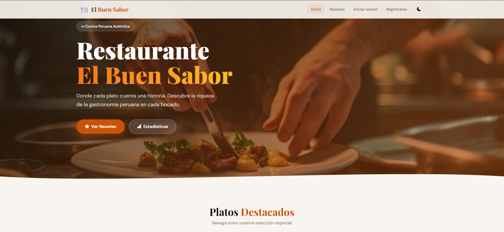
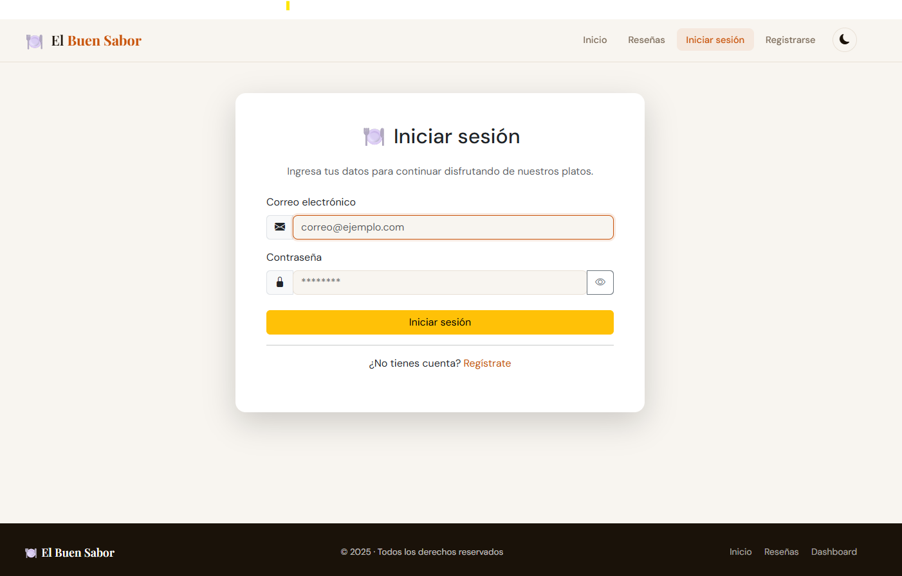
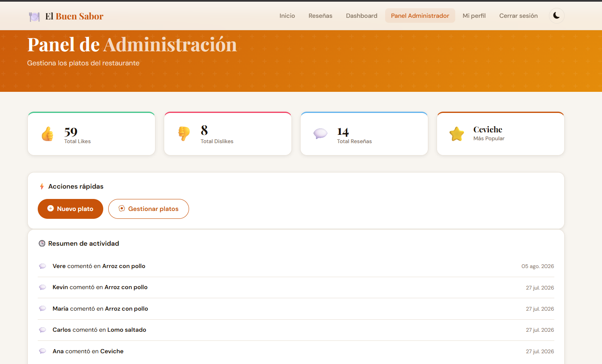
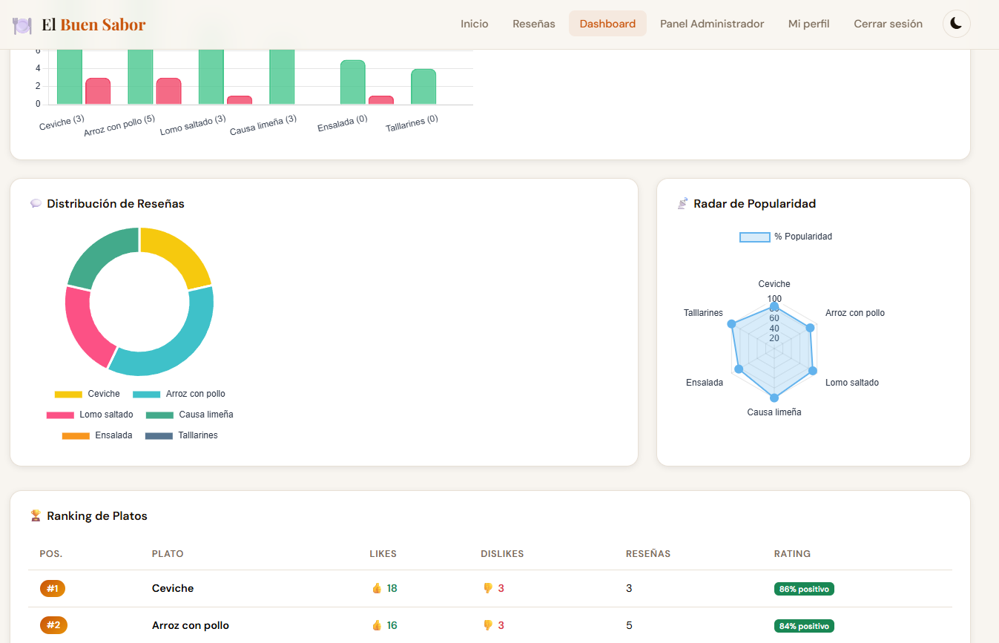

# 🍽️ El Buen Sabor — Sistema de Gestión de Restaurante

Aplicación web full-stack desarrollada con Flask y MySQL. Diseñada para gestionar platos, reseñas de usuarios y estadísticas del restaurante mediante una interfaz adaptable e intuitiva.

## ✨ Funcionalidades

- **Autenticación de usuarios:** Registro, inicio de sesión y almacenamiento seguro de contraseñas mediante hash.
- **Control de acceso por roles:** Permisos diferenciados para administradores y usuarios regulares.
- **Gestión de platos:** Crear, editar y eliminar platos con sus descripciones, precios e imágenes.
- **Reseñas y comentarios:** Los usuarios pueden compartir sus opiniones e interactuar con los platos.
- **Likes y dislikes:** Registro de las preferencias de los usuarios sobre los platos del restaurante.
- **Panel de estadísticas:** Visualización de la actividad del restaurante y las interacciones de los usuarios.
- **Interfaz adaptable:** Experiencia de usuario intuitiva en diferentes tamaños de pantalla.

## 🛠️ Tecnologías

- Python
- Flask
- MySQL
- HTML5
- CSS3
- JavaScript
- Git y GitHub

## 🏗️ Arquitectura

La aplicación sigue el patrón **Modelo-Vista-Controlador (MVC)** para organizar sus componentes:

- **Modelos:** Operaciones con la base de datos y gestión de datos.
- **Vistas:** Plantillas HTML renderizadas mediante Flask.
- **Controladores:** Lógica de la aplicación y gestión de solicitudes.
- **Rutas:** Endpoints de la aplicación y navegación.

## 📸 Capturas de pantalla

### Página principal

### Inicio de sesión

### Panel de administración

### Panel de estadísticas

## 🚀 Cómo ejecutar el proyecto

Para ejecutar el proyecto localmente, necesitas Python, MySQL y las dependencias requeridas.

1. Clona el repositorio.
2. Instala las dependencias desde `requirements.txt`.
3. Configura las variables de entorno locales en un archivo `.env`.
4. Configura la base de datos MySQL utilizando los archivos SQL proporcionados.
5. Ejecuta la aplicación Flask.

## 🔐 Variables de entorno

Configura las siguientes variables en tu archivo `.env` local:

- `SECRET_KEY`
- `MYSQL_HOST`
- `MYSQL_PORT`
- `MYSQL_USER`
- `MYSQL_PASSWORD`
- `MYSQL_DB`

**No subas tu archivo `.env` ni tus credenciales a GitHub.**

## 👨‍💻 Autor

Kevin Carvallo

GitHub: [@kevinesty](https://github.com/kevinesty)
